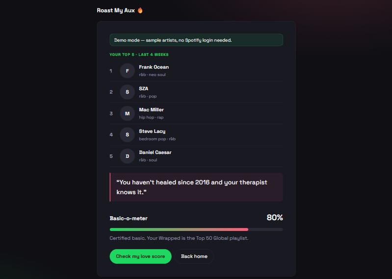

# Roast My Aux 🔥

A Flask web app that logs in with Spotify, pulls your top artists, and roasts your music taste.
Nobody's dating anyway.



## Features
- **Spotify roast** — your top 5 artists (last 4 weeks, 6 months, or all time) with photos and genres, then a roast matched by artist, falling back to genre
- **Basic-o-meter** — how mainstream your taste is, from the artists' Spotify popularity scores
- **Love readiness score** — derived from your top artists (same taste, same score), with a consolation cat photo if it goes badly
- **Pickup line generator** — never the same line twice in a row
- **Demo mode** — try everything with sample data, no Spotify account needed

## Tech
Python · Flask · Jinja templates · Spotify Web API (OAuth 2.0 via [Spotipy](https://spotipy.readthedocs.io/)) · The Cat API · responsive CSS

## How it works
- **OAuth login:** `/login` sends you to Spotify, and `/callback` exchanges the code for a token.
- **No token files:** tokens are stored only in the signed Flask session cookie (`FlaskSessionCacheHandler`) and refreshed automatically when they expire. Nothing is written to disk.
- **Roast engine:** checks each artist against `data/artist_roasts.json`, then their genres against `data/genre_roasts.json`, then falls back to a generic line.
- **Data files:** all jokes live in `data/*.json`, so adding roasts doesn't touch the code.
- **Error handling:** missing keys, cancelled logins and Spotify errors show a friendly page that points you to the demo.

## Run it locally
```bash
pip install -r requirements.txt
cp .env.example .env   # add your Spotify app's client ID and secret
python app.py
```
Open http://127.0.0.1:5000. Without Spotify keys, the demo still works.

To enable Spotify login, create an app at the [Spotify developer dashboard](https://developer.spotify.com/dashboard)
and add `http://127.0.0.1:5000/callback` as a redirect URI. Apps in development mode only allow
Spotify accounts you've added under **User Management**.
